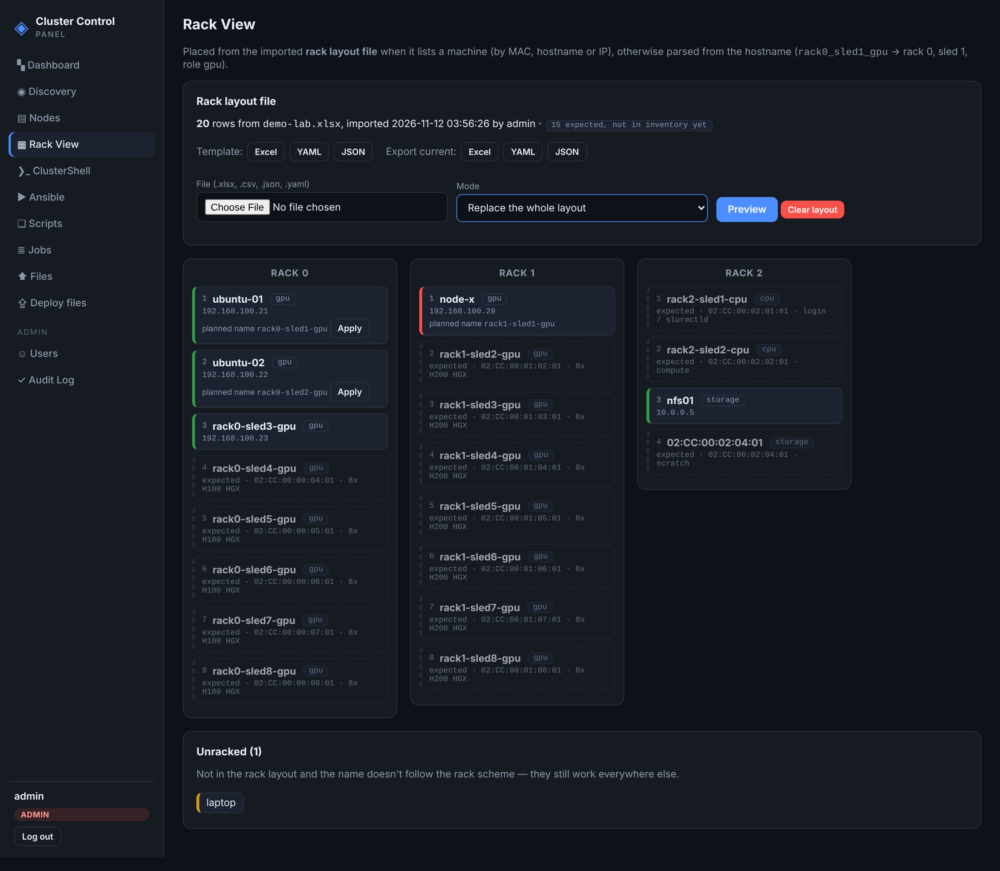

# Rack layout examples

Import on **Rack View → Rack layout file → Preview → Apply layout**.

| File | What it is |
|---|---|
| `rack-layout-template.xlsx` / `.yaml` / `.json` | Empty-ish starter (3 example rows) — same files the Rack View *Template* buttons serve. The `.xlsx` has a README sheet. |
| `demo-lab.xlsx` / `.csv` / `.json` / `.yaml` | Demo lab, 20 machines: rack 0 = 8× GPU (H100), rack 1 = 8× GPU (H200), rack 2 = 2× CPU + 2× storage. All four files hold the same layout; the YAML uses the grouped-by-rack form. |

## Columns

| Column | Required | Notes |
|---|---|---|
| `rack` | yes | `0`, `3`, `rack3`, `Rack 03`, `R3` all accepted |
| `sled` | no | slot inside the rack; unique per rack (`slot`, `position`, `U12` accepted) |
| `mac` | one of mac / hostname / ip | preferred identifier (PXE NIC); any common MAC format |
| `hostname` | 〃 | planned name — Discovery import names the machine after it |
| `ip` | 〃 | used only when mac and hostname don't match |
| `role` | no | `gpu`, `cpu`, `storage`, … |
| `notes` | no | free text, shown on expected slots |

Matching precedence: MAC > hostname > IP > hostname parsing. Rows that match no
node yet appear as dashed **expected** slots. Any invalid row rejects the whole
file (the preview lists every problem with its row number).

The demo MACs (`02:CC:00:<rack>:<sled>:01`) are fake, locally administered
addresses — replace them with your machines' PXE NIC MACs.

